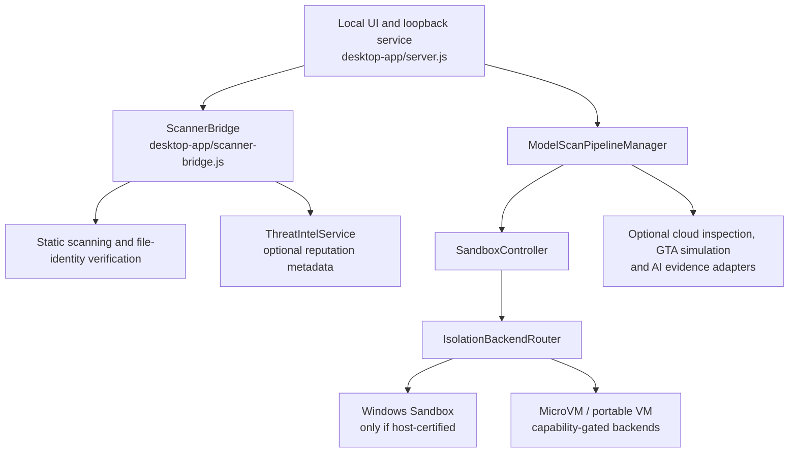

# MalGuard Core

**Open-source defensive scanning and isolation-routing foundations for safer game modifications and suspicious-file inspection.**

[](LICENSE)
[](https://www.bestpractices.dev/projects/16122)
[](https://github.com/MalGuard/malguard-core/actions/workflows/windows-release-candidate.yml)
[](DESKTOP-VERSION)
[](https://github.com/MalGuard/malguard-core/releases)

[Website](https://malguard.site/) · [Documentation](https://malguard.site/docs.html) · [Trust Center](https://malguard.site/trust.html) · [Security policy](SECURITY.md) · [Contributor quickstart](docs/CONTRIBUTOR_QUICKSTART.md)

**OpenSSF Best Practices (Baseline Level 1):** [View MalGuard Core's current badge status and self-assessment](https://www.bestpractices.dev/projects/16122). This badge reflects project-submitted open-source practices; it is **not** an independent security audit, malware-detection certification, or Windows Authenticode code-signing certificate.

## Try it now — no installation or account

**Checking a suspicious game-mod link?** Try the [free Link Inspector](https://malguard.site/tools.html#link-inspector) on the public MalGuard website. Click **Try example** to see what a deceptive link can look like, then check a link's visible URL structure in your own browser. **The tool does not visit the destination or upload the pasted URL**, and it cannot determine whether a site is safe.

**Checking a downloaded file's identity?** Open the [local SHA-256 File Fingerprint tool](https://malguard.site/tools.html#file-fingerprint). It hashes a file in your browser without uploading it to MalGuard. A hash is an identifier, **not a malware verdict**. Do not open untrusted executable files simply to test them.

These browser-only tools live in the [public website source repository](https://github.com/MalGuard/malguard.github.io), while **this repository** contains the GTA Guard scanning and sandbox-routing source. Some Windows release and isolation features are still pre-release or unavailable on some systems.

**For developers:** [run a harmless source-contract test](#developer-quick-start) · [read the trust model](SECURITY.md) · [pick a good first issue](https://github.com/MalGuard/malguard-core/issues?q=is%3Aissue+is%3Aopen+label%3A%22good+first+issue%22). If you find MalGuard useful, starring this repository is an optional way to bookmark the work; thoughtful bug reports and contributions are especially valuable.

MalGuard is a developing defensive-security project focused on game modifications and other untrusted files. The goal is to surface file, archive, script, and executable risk signals while **failing closed** when evidence, provenance, or required isolation is missing. This repository contains the core and local service for GTA Guard and related components; it is **not** a claim that any file declared clean is guaranteed harmless.

> **Status:** active pre-release source; `package.json` and `DESKTOP-VERSION` identify **0.8.0-beta.7**. Runtime certification, release signing, availability of optional services, and the readiness of a specific distribution are separate gates. Do not equate synthetic tests with production-grade execution isolation.

## What exists in this repository

These are source-backed components, not independently audited effectiveness claims:

- **Local file and scanner integration:** `desktop-app/scanner-bridge.js` and `desktop-app/server.js` provide the loopback desktop service, scanner integration, file identity checks, and structured fail-closed results.
- **Static inspection and regression contracts:** tests cover supported archive/script/PE-oriented inspection, malformed input, identity revalidation, scanner resilience, and secure result handling.
- **Sandbox coordination:** `desktop-app/sandbox/` contains sandbox controllers and isolation backend routing. Windows Sandbox is optional where supported and *must not* be treated as certified without host-specific acceptance. MicroVM/portable-VM paths have their own readiness gates.
- **Threat-intelligence integration:** `desktop-app/threat-intel/` includes metadata-oriented services and MalwareBazaar client contracts; external services depend on credentials/configuration and availability.
- **GTA simulation and AI evidence plumbing:** `desktop-app/gta-simulation/` contains orchestration and optional provider interfaces. Not every backend is enabled or certified in every environment.
- **Integrity and update controls:** package/source provenance, runtime integrity verification, update/release policy, and signing constraints are checked by code and regression tests.
- **Read-only local MCP tools:** `tools/malguard-mcp-server.mjs` exposes bounded status, sandbox-health, and redacted diagnostics tools, without arbitrary command execution.

Security outcomes should remain `SAFE`, `SUSPICIOUS`, `MALICIOUS` or `INCONCLUSIVE` only when the responsible component has supporting evidence. **Inconclusive is not safe**. Platform-dependent capabilities are explicitly gated.

## Architecture (source-level overview)



The diagram documents module relationships, not a promise that each optional path is deployed, available, or release-approved.

## Developer quick start

**Requirements:** Git and Node.js 20+; additional native/Windows-specific dependencies may be needed for platform acceptance. Start with **harmless synthetic fixtures only**.

```bash
git clone https://github.com/MalGuard/malguard-core.git
cd malguard-core
node --version
node tests/version-consistency.test.js
```

The focused version check reads `DESKTOP-VERSION` and `package.json`; both files and the test entry point exist in this source tree.

For the broader, environment-sensitive regression suite:

```bash
node tests/run-all.js
```

The npm package also maps `npm test` to that same suite. It may require additional platform setup and takes longer; report failures rather than bypassing a safety gate. A local CLI test does **not** certify a Windows sandbox.

For **development-only** use of the loopback desktop service:

```bash
npm install --ignore-scripts
npm start
```

The `start` script runs `desktop-app/server.js` with its integrity/health preloads and binds to `127.0.0.1:18777` by default. This is a source-development workflow, **not** an end-user install or an assurance that every optional backend works on your host. Do not process real malware or unknown executable samples during development.

More entry points: `npm run diagnose` (may exit nonzero when a readiness condition fails), `npm run verify:readiness` (strict acceptance gate), and `npm run mcp:stdio` (requires installed package dependencies). They are diagnostics, not claims of certification.

## Security and privacy

- File input, paths, update data, and scan metadata are treated as attacker-controlled.
- Required evidence missing → fail closed; a partial/failed scan cannot be promoted to a clean verdict.
- No real malware may be downloaded, committed, uploaded, or executed in repository tests or CI.
- Runtime isolation, package integrity, Windows release signing, and unsigned-preview distribution have separate controls.
- Reporting is private-first: see [SECURITY.md](SECURITY.md). Read [PRIVACY.md](PRIVACY.md) and [CODE_SIGNING_POLICY.md](CODE_SIGNING_POLICY.md).

## Related MalGuard projects

- [MalGuard malware-ai](https://github.com/MalGuard/malware-ai) — a related repository for malware-analysis and AI integration; assess capabilities in its own source and documentation.
- [MalGuard website](https://github.com/MalGuard/malguard.github.io) / [malguard.site](https://malguard.site/) — the public-facing website covering MalGuard AI, GTA Guard, Game Scam Guard and Threat Radar.
- [Roadmap and current limitations](docs/ROADMAP.md) · [Maintenance evidence](docs/MAINTAINER_EVIDENCE.md) · [Changelog](CHANGELOG.md)

## Contributing and maintenance

We welcome focused, reviewable defensive-security contributions. Start with the [5-minute quickstart](docs/CONTRIBUTOR_QUICKSTART.md), [CONTRIBUTING.md](CONTRIBUTING.md), and [good first issues](https://github.com/MalGuard/malguard-core/issues?q=is%3Aissue+is%3Aopen+label%3A%22good+first+issue%22). Normal bugs go through issue forms; possible vulnerabilities should be reported privately via **contact@malguard.site**. See [CODE_OF_CONDUCT.md](CODE_OF_CONDUCT.md) and [PR template](.github/PULL_REQUEST_TEMPLATE.md).

**License:** [MIT](LICENSE). Project founder and lead developer: Mohammadreza Azarderakhsh. No third-party audit, adoption total, release certification, or funding approval is implied by this README.
